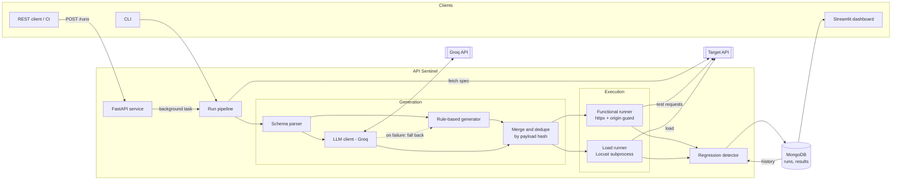
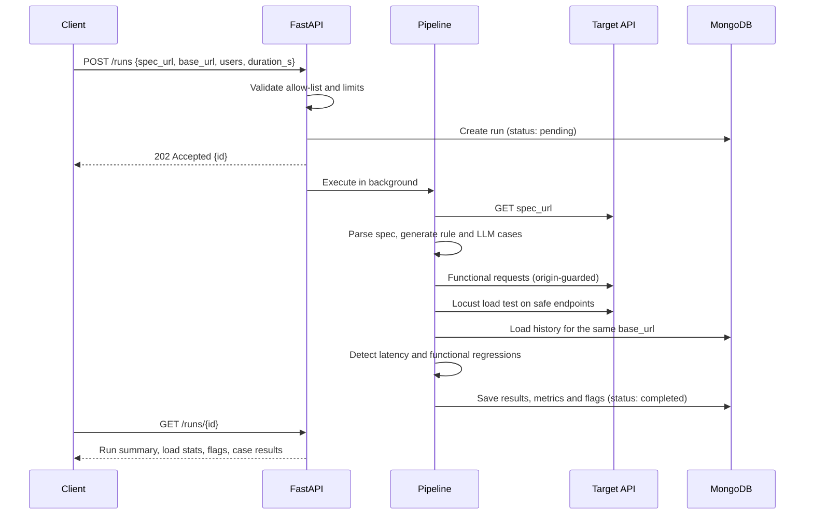

# API Sentinel

[](https://github.com/Mona-Agrawall/api-sentinel/actions/workflows/ci.yml)


API Sentinel is an automated API regression-testing service. Point it at an OpenAPI 3.x
specification and a base URL. It then:

- generates edge-case tests for every endpoint, using deterministic rules plus LLaMA-3 via Groq,
- runs those tests and a Locust load test against the API,
- stores every run in MongoDB,
- flags new functional failures and latency regressions against recent history.

You can drive it through a REST API, a CLI suitable for CI gates, or a Streamlit dashboard.

## Contents

- [Motivation](#motivation)
- [Features](#features)
- [Architecture](#architecture)
- [Tech stack](#tech-stack)
- [Getting started](#getting-started)
- [Usage](#usage)
- [Configuration](#configuration)
- [Regression detection](#regression-detection)
- [Results](#results)
- [Testing and quality](#testing-and-quality)
- [Project structure](#project-structure)
- [Security](#security)
- [Limitations](#limitations)
- [Further documentation](#further-documentation)
- [License](#license)

## Motivation

When a backend API changes, two kinds of breakage tend to go unnoticed:

1. **Functional edge cases.** Handlers mishandle nulls, missing optional fields, boundary
   numbers, wrong types and over-long strings. These tests are tedious to write by hand, so
   they are rarely written. The result is a `500` in production where a `4xx` was expected.
2. **Performance regressions.** One endpoint gets slower after a change. Without run-over-run
   comparison, nobody notices until users do.

API Sentinel needs nothing beyond the specification. It derives the edge cases, executes them
together with a load test, and compares each run against the runs before it.

## Features

- **Specification parsing.** Reads OpenAPI 3.0 and 3.1 in JSON or YAML. It resolves local `$ref`s
  with cycle detection and normalises `allOf`, `anyOf`/`oneOf`, `nullable`, and both styles of
  exclusive bounds.
- **Rule-based case generation.** Generates deterministic boundary, type, enum, null, length and
  missing-field cases for path, query and body parameters. Each case has a stable payload hash
  so it can be compared run over run.
- **LLM case generation.** Asks Groq (LLaMA-3, configurable) for additional cases, using
  versioned prompts and JSON-mode output. Every response is validated with Pydantic before use.
  If the LLM fails, the run falls back to the rule-based cases and records that it did.
- **Functional runner.** An async `httpx` runner with bounded concurrency. Each case declares an
  expected outcome (`2xx`, `4xx` or `not_5xx`), and a `5xx` or a transport error always counts as
  a failure.
- **Load testing.** Runs Locust headless in an isolated subprocess and reports p50, p95 and p99
  latency, request count and failure count for each endpoint.
- **Regression detection.** Flags latency regressions against a median baseline, using both a
  relative and an absolute threshold. It also flags new `5xx` responses and cases that passed in
  the previous run but fail now.
- **Persistence.** Stores runs and per-case results in MongoDB with indexes. An in-memory
  `mongomock://` backend is available for local use and tests.
- **Interfaces.** A FastAPI service, a CLI whose exit code can gate a CI pipeline, and a Streamlit
  dashboard with latency trend charts and per-case drill-down.
- **Demo target.** A small store API with a switch that injects a 200 ms delay into one endpoint
  and an unhandled-null bug into another, used to demonstrate end-to-end detection.

## Architecture



### Run lifecycle



The run is saved after each stage, so its progress is visible while it executes. A failure at
any stage marks the run `failed` and records the error. A failed load test is recorded separately
and does not discard the functional results.

## Tech stack

| Area | Technology |
|---|---|
| API service | FastAPI, Uvicorn, Pydantic v2, pydantic-settings |
| HTTP client | httpx (async) |
| Load testing | Locust (headless, programmatic) |
| LLM | Groq OpenAI-compatible API, LLaMA-3 |
| Storage | MongoDB (pymongo), mongomock for tests |
| Dashboard | Streamlit, Altair, pandas |
| Quality | pytest, ruff, mypy (strict) |
| Delivery | Docker, Docker Compose, GitHub Actions |

## Getting started

### Prerequisites

- Python 3.11 or later
- Docker and Docker Compose, for MongoDB or the full stack
- Optional: a [Groq API key](https://console.groq.com/keys) for LLM-generated cases

### Run with Docker Compose

```bash
git clone https://github.com/Mona-Agrawall/api-sentinel.git
cd api-sentinel
cp .env.example .env            # optionally set GROQ_API_KEY
docker compose up --build
```

| Service | URL |
|---|---|
| API Sentinel API | http://localhost:8000 (interactive docs at `/docs`) |
| Dashboard | http://localhost:8501 |
| Demo target API | http://localhost:9000 |
| MongoDB | localhost:27017 |

If a host port is already in use, override it, for example `API_PORT=8001 docker compose up`.
The available variables are `API_PORT`, `DASHBOARD_PORT`, `TARGET_PORT` and `MONGO_PORT`.

To restart the demo target with its faults enabled:

```bash
TARGET_API_FAULTS=1 docker compose up -d target_api
```

### Run locally

```bash
python -m venv .venv
source .venv/bin/activate                     # Windows: .venv\Scripts\activate
pip install -r requirements-dev.txt
cp .env.example .env

docker compose up -d mongo                    # or set MONGODB_URI=mongomock://local

uvicorn target_api.app:app --port 9000        # demo target (optional)
uvicorn app.main:app --port 8000              # API Sentinel API
streamlit run app/dashboard/streamlit_app.py  # dashboard
```

## Usage

### REST API

Start a run. The API returns `202 Accepted` with the run id, and the run executes in the
background.

```bash
curl -X POST http://localhost:8000/runs \
  -H "Content-Type: application/json" \
  -d '{
        "spec_url": "http://127.0.0.1:9000/openapi.json",
        "base_url": "http://127.0.0.1:9000",
        "users": 10,
        "duration_s": 15
      }'
```

When running under Docker Compose, use `http://target_api:9000` for both URLs, because the API
container reaches the target by its service name.

| Method | Endpoint | Description |
|---|---|---|
| `POST` | `/runs` | Start a run with `{spec_url, base_url, users, duration_s}` |
| `GET` | `/runs?limit=&base_url=` | List runs, newest first, optionally filtered by target |
| `GET` | `/runs/{id}` | Run summary, load statistics, flags and every case result |
| `GET` | `/health` | Liveness and database connectivity |

### CLI

The CLI runs the full pipeline without the API server. It exits with a non-zero status when the
run fails or raises any flag, so it can be used as a CI quality gate.

```bash
python -m app.cli run \
  --spec-url http://127.0.0.1:9000/openapi.json \
  --base-url http://127.0.0.1:9000 \
  --users 10 --duration 15
```

### Dashboard

The Streamlit dashboard lists recent runs. It plots p95 latency per endpoint over time and marks
flagged points. For a selected run it shows load statistics, the flags raised, the LLM fallback
status, and a filterable table of every case result.

### Reproducing the demo

The demo script starts the target API, records a set of baseline runs, restarts the target with
faults enabled, and runs once more. It writes the outcome to `docs/demo_results.json`.

```bash
python scripts/run_demo.py --baseline-runs 3 --users 10 --duration 15
```

## Configuration

All settings are read from environment variables. See [`.env.example`](.env.example) for a
template.

| Variable | Default | Description |
|---|---|---|
| `GROQ_API_KEY` | empty | Groq API key. When empty, only rule-based cases are generated. Never logged. |
| `GROQ_MODEL` | `llama-3.3-70b-versatile` | Groq chat model |
| `LLM_ENABLED` | `true` | Disable LLM generation without removing the key |
| `LLM_TIMEOUT_S` | `30` | Timeout per LLM request (one retry on failure) |
| `LLM_MAX_CASES_PER_ENDPOINT` | `12` | Maximum LLM cases per endpoint |
| `MONGODB_URI` | `mongodb://localhost:27017` | MongoDB URI; `mongomock://...` selects an in-memory store |
| `MONGODB_DB` | `api_sentinel` | Database name |
| `TARGET_ALLOWLIST` | `localhost,127.0.0.1,target_api` | Hosts permitted for `spec_url` and `base_url` |
| `REQUEST_TIMEOUT_S` | `10` | Timeout per functional request |
| `FUNCTIONAL_CONCURRENCY` | `10` | Maximum concurrent functional requests |
| `MAX_CASES_PER_ENDPOINT` | `60` | Maximum rule-based cases per endpoint |
| `MAX_USERS` / `MAX_DURATION_S` | `200` / `600` | Upper limits accepted by `POST /runs` |
| `LOAD_INCLUDE_UNSAFE_METHODS` | `false` | Also load-test `POST`, `PUT`, `PATCH` and `DELETE` |
| `REGRESSION_BASELINE_RUNS` (K) | `5` | Number of previous runs in the latency baseline |
| `REGRESSION_PCT_THRESHOLD` (X) | `20` | Minimum relative slowdown, in percent, to flag |
| `REGRESSION_MS_THRESHOLD` (Y) | `50` | Minimum absolute slowdown, in milliseconds, to flag |
| `LOG_LEVEL` | `INFO` | Python log level |
| `TARGET_API_FAULTS` | off | Demo target only. Set to `1` to inject the 200 ms delay and the null bug. |

## Regression detection

### Latency

Latency is evaluated per endpoint. Only completed runs against the same `base_url` with the
same load profile (`users` and `duration_s`) count as history, so a heavier run is never
compared with baselines measured under lighter load.

```
baseline_p95 = median(p95 of the endpoint over the last K completed runs)
delta_ms     = current_p95 - baseline_p95
delta_pct    = delta_ms / baseline_p95 * 100

flagged if and only if  delta_pct > X  and  delta_ms > Y
```

- Using the **median** keeps a single noisy historical run from shifting the baseline.
- Requiring **both thresholds** filters out noise. A 100% increase on a 2 ms endpoint is only
  2 ms, and a 60 ms increase on a 3 s endpoint is only 2%. Neither is actionable.

### Functional

Each case is compared, by payload hash, against the most recent previous run of the same
target, whatever its load profile.

- `new_5xx`: the case returns a `5xx` now and did not in the previous run. On a target's first
  run, every `5xx` is new.
- `newly_failing`: the case passed in the previous run and fails now.

Rule-based cases are deterministic, so the same specification produces the same hashes on every
run. That stability is what makes run-over-run comparison possible.

### Pass and fail criteria

| Expectation | Passes when |
|---|---|
| `2xx` | Status is 200-299 |
| `4xx` | Status is 400-499 |
| `not_5xx` | Status is below 500. Used where the outcome depends on server state, such as a resource id that may not exist. |

A `5xx` response or a transport error always fails.

## Results

All figures below come from a single real execution of
`python scripts/run_demo.py --baseline-runs 3 --users 10 --duration 15`, recorded on
2026-10-25 (UTC). The raw output is in [`docs/demo_results.json`](docs/demo_results.json).

**Environment:** Windows 11, Python 3.12.10, MongoDB 7 in Docker, target API on `127.0.0.1`.
No Groq API key was configured, so the run recorded an LLM fallback and all 60 cases were
rule-based.

### Latency regression detected

`GET /items/{item_id}` with the injected 200 ms delay:

| Run | p50 | p95 | Flag |
|---|---|---|---|
| Baseline runs 1 / 2 / 3 | 2 ms (run 3) | 3 / 2 / 3 ms (median 3 ms) | none |
| Faulty run | 200 ms | 220 ms | `latency_regression`: +217 ms, +7233% |

The other three load-tested endpoints stayed at a p95 of 4-5 ms in the faulty run and were not
flagged.

### Unhandled null detected

In the faulty run, 58 of 60 cases passed. The 2 failures were both on `POST /items`, and both
returned `500`. The baseline runs had no failures.

| Case | Request body | Status |
|---|---|---|
| `description: null` | `{"name": "test", "price": 1.0, "quantity": 1, "category": "books", "description": null}` | 500 |
| `body: only required fields` | `{"name": "test", "price": 1.0, "quantity": 1, "category": "books"}` | 500 |

Both raised `new_5xx` flags. The specification declares `description` as optional and nullable,
but the handler calls `.strip()` on it without a null check.

These results cover rule-based generation only. The extra coverage from LLM-generated cases has
not yet been benchmarked; to measure it, set `GROQ_API_KEY` and rerun the demo.

## Testing and quality

```bash
ruff check .
ruff format --check .
mypy app target_api tests scripts
pytest                         # full suite, including the integration tests
pytest -m "not integration"    # unit tests only
```

The suite contains 69 tests:

- unit tests for each module,
- an end-to-end pipeline test against the demo target, served in-process,
- an integration test that starts a real Uvicorn server and a real Locust load test.

The LLM client is tested against a mocked Groq API. Those tests cover retries, fallback,
validation, and confirm that the API key never appears in logs.

GitHub Actions ([`ci.yml`](.github/workflows/ci.yml)) runs linting, format checks, strict type
checking, the full test suite, and a Docker image build on every push and pull request.

## Project structure

```
api-sentinel/
├── app/
│   ├── main.py                 FastAPI service: /runs, /runs/{id}, /health
│   ├── config.py               Environment-driven, validated settings
│   ├── pipeline.py             Orchestrates a run end to end
│   ├── cli.py                  Command-line entry point
│   ├── generator/
│   │   ├── schema_parser.py    OpenAPI 3.0/3.1 -> endpoints, parameters, body fields
│   │   ├── rule_cases.py       Deterministic edge-case generation
│   │   ├── llm_client.py       Groq client: JSON mode, timeout, retry, validation
│   │   ├── prompts.py          Versioned prompt templates
│   │   ├── generate.py         Merges rule and LLM cases, records fallback
│   │   └── models.py           Test case model and payload hash
│   ├── runner/
│   │   ├── functional.py       Async functional runner with origin guard
│   │   ├── load.py             Launches the Locust worker, collects statistics
│   │   └── locust_worker.py    Headless Locust process
│   ├── regression/
│   │   └── detector.py         Latency and functional regression detection
│   ├── db/                     Models, MongoDB client factory, repository and indexes
│   └── dashboard/
│       └── streamlit_app.py    Streamlit dashboard
├── target_api/app.py           Demo store API with fault-injection switch
├── scripts/run_demo.py         Reproduces the Results section
├── tests/                      Unit and integration tests
├── docs/                       Problem statement, walkthrough, demo results
├── Dockerfile
├── docker-compose.yml
└── pyproject.toml              Ruff, mypy and pytest configuration
```

## Security

- **Restricted outbound traffic.** Test traffic is sent only to the run's `base_url`, whose host
  must appear in `TARGET_ALLOWLIST`. Every outgoing request passes through an origin guard, and
  redirects are not followed, so neither a malicious specification nor LLM output can send
  traffic elsewhere.
- **SSRF protection.** `spec_url` is subject to the same allow-list, and the specification
  download is size-limited.
- **Constrained LLM output.** LLM-generated cases may only set values for parameters declared in
  the specification. Cases that reference unknown parameters are discarded.
- **Secret handling.** Secrets are read only from the environment and held as `SecretStr`. Tests
  assert that the API key never appears in log output.
- **Container.** The container image runs as a non-root user.

## Limitations

- Only top-level request-body fields are mutated; nested objects are sent with valid values.
  Header and cookie parameters are parsed but not mutated.
- Only JSON request bodies are supported (no form data or file uploads), and only local `$ref`s
  are resolved.
- Authentication is not handled, so protected endpoints respond with `401` or `403`.
- By default, load tests replay each endpoint's valid baseline request against `GET` and `HEAD`
  endpoints only. Locust rounds percentiles above 100 ms to two significant digits.
- Latency baselines are scoped to a `base_url` and load profile, and need at least one previous
  completed run with that profile. Measurements are only comparable on the same hardware.
- On Windows, use `127.0.0.1` rather than `localhost` for local targets. `localhost` resolves to
  IPv6 first while Uvicorn listens on IPv4, which produced p99 outliers of around 2 s during
  development.
- Supports REST APIs described by OpenAPI 3.x only. Swagger 2.0 and GraphQL are not supported.
  This is a regression-testing tool, not a security scanner.

## Further documentation

- [`docs/problem_statement.md`](docs/problem_statement.md): problem definition, goals and
  non-goals
- [`docs/WALKTHROUGH.md`](docs/WALKTHROUGH.md): module-by-module walkthrough of the design
  decisions and failure modes, with review questions

## License

Released under the [MIT License](LICENSE).
